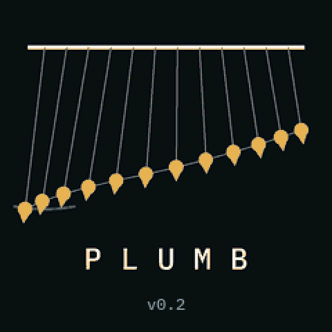
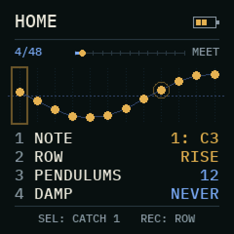
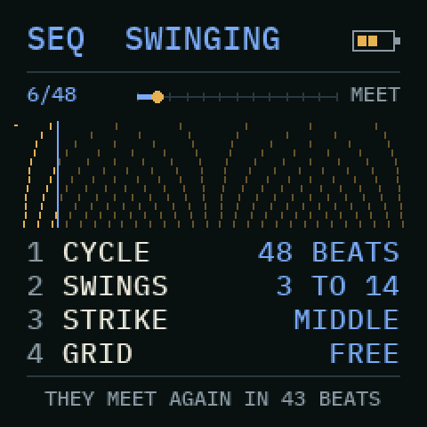
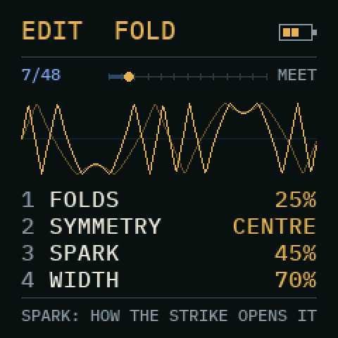

# PLUMB

  
  

  
  

> [!WARNING]
> **Not tested on a real FM‑1 yet.** PLUMB has only been tested on a computer. Install it on your FM‑1 at your own risk, and keep the stock firmware or another firmware ready to flash back.

PLUMB is a firmware for the **M‑VAVE FM‑1** where **the rhythm is a pendulum wave**.

Twelve pendulums hang in a row, each a little shorter than the one before. They hang still until **PLAY releases
them together.**
Pendulum *k* swings `SWINGS + k` times in one CYCLE, so they leave in a line, turn into a snake, split into two rows,
three, scatter into what looks like chaos, and **meet again, all in a line, at the end of the cycle**. Each time a bob
passes its strike point it plays its note. Nothing is random; nothing repeats until the cycle does.

- **The rhythm is physics (SEQ)**: CYCLE (4 to 64 beats), SWINGS (how fast the slowest one goes), STRIKE (the middle,
  one way, the left wall, both walls) and GRID (FREE, or the strikes snapped to 1/32 .. 1/4: a pendulum wave becomes
  twelve Euclidean rhythms).
- **The row (HOME)**: a note for each pendulum, as a scale step. ROW shapes all twelve at once (RISE, FALL, ARCH,
  VALLEY, ZIGZAG, CHORD, FIFTHS, SCATTER); **REC** plays new notes into the row, one pendulum after the other.
  **SEL catches** a pendulum (it hangs still, silent) and lets it swing again, back in its place in the wave.
  DAMP lets them tire: the swing, and the sound, fades over 1 to 32 cycles.
- **Three oscillator engines (ALGORITHM)**, none of them a resonator or a plucked string:
  **FOLD** (West Coast: a sine through a wavefolder into a low-pass gate), **PHASE** (Casio CZ phase distortion: saw,
  square, pulse, double) and **PULSAR** (Curtis Roads' pulsar synthesis: a grain of sine a cycle, its formant and its
  duty). **SPARK** is how much the strike itself opens the sound.
- **The ARP lets the pendulums play your keys**: hold a chord and the strikes walk through it (UP, DOWN, BOUNCE,
  RANDOM, or SPREAD: pendulum *k* plays note *k*), with RANGE, CHANCE and LATCH.
- **The LFO** moves PITCH, FOLDS (DCW, FORMANT), SPARK or LEVEL, or **bends time**: its GRAVITY target pulls the
  pendulums ahead and holds them back, and they still meet.
- **48 scales**, common and exotic. On the GLO page the keys transpose everything.
- **The cycle line is on every page**: the beat of the cycle, and when they meet again.
- **Dinghy inside**: MIDI clock sync (a DAW's START releases the pendulums on its downbeat), MIDI in and out (every
  strike goes out as a note), USB audio, FM‑1 Mirror, the backup page.
- **8 presets and 8 USER slots** that SAVE keeps: the sound, the swing, the row and the scale.
- **Every button does what it says**, one page each, no menus inside menus.

[Read the operator manual](docs/OPERATOR-MANUAL.md) · [Credits and licenses](LICENSING.md) · [Changelog](CHANGELOG.md)

**Version 0.2** builds as `plumb.fwsc` (a tagged release: `plumb-0.2.fwsc`). The host tests pass. It has **not yet
been installed on a physical FM‑1**.

## Build

PLUMB builds like [Dinghy](https://github.com/zvenson/dinghy), the platform it is written on: Python 3 with Pillow, the
JieLi toolchain (`tools/get_toolchain.sh`) and three files of the JieLi AC79 SDK, then `sh build.sh`
(macOS: through Docker). `sh tests/run_host.sh` runs PLUMB on your computer: the screens as PNG, the sound as WAV.
Every push to `main` builds the package on GitHub and leaves it on the `build` branch.

## Credits

PLUMB is written on [Dinghy](https://github.com/zvenson/dinghy) by zvenson (its platform, MIDI clock sync, MIDI,
mirror and backup kit), which carries the [Felucca](https://github.com/hugelton/Felucca) and
[SLOOP](https://github.com/isod89/sloop-fm1) platform work. The delay, hall, chorus, the scales and the look of the
pages come from [LOOPHEADS](https://github.com/jaak-stjaaques/LOOPHEADS-public),
[BEACHCOMBER](https://github.com/jaak-stjaaques/Beachcomber) and [BUOY](https://github.com/jaak-stjaaques/BUOY). The
screen font is [IBM Plex Mono](https://github.com/IBM/plex). The pendulum wave is an old physics classroom demonstration;
pulsar synthesis is Curtis Roads'; phase distortion is Casio's CZ series'.

The firmware is distributed under [GPL-3.0-only](LICENSE). The [full credits](LICENSING.md) keep the upstream notices
and list the separately licensed assets.
