# PLUMB operator manual

PLUMB 0.3 for the M‑VAVE FM‑1. Twelve pendulums, one row of notes, three oscillator engines.

## The idea in one minute

<p align="center">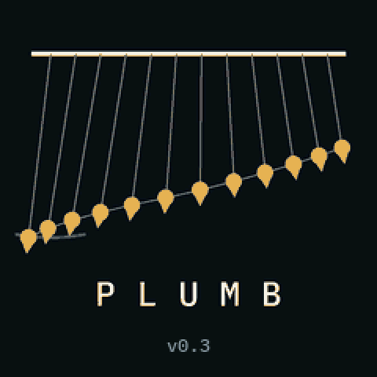</p>

Twelve pendulums hang in a row. When they are released together, pendulum 1 swings `SWINGS` times in one cycle,
pendulum 2 `SWINGS + 1` times, pendulum 12 `SWINGS + 11` times. Because every one of them makes a whole number of
swings in the cycle, they drift apart, form waves, rows and chaos, and are **all back in a line at the end of the
cycle**. Every time a bob passes its strike point, it plays its note.

You do not program a pattern. You choose how they swing (SEQ), what each one plays (HOME), and what a strike sounds
like (EDIT, ENV, LFO, FX). Then you listen to them meet.

Two colours on the screen carry the idea: **brass** is the bobs (the notes, the sound), **chalk blue** is the swing
(time).

## On every page

```
HOME                       [battery]     the page
7/48 ──────●────────────── MEET          the cycle line: beat 7 of 48; they meet at the end
[ the picture ]
1 NOTE              1: C3                the four knobs, KNOB 1..4
2 ROW                RISE
3 PENDULUMS            12
4 DAMP              NEVER
SEL: CATCH 1   REC: ROW                  what a button does here, or what just happened
```

**MEET** lights up as they come together. **STOPPED** means the transport is stopped (PLAY), **STILL** that DAMP
has let them come to rest.

PLUMB is silent at power-on: the pendulums hang still until you press **PLAY**.

## The panel

| Control | What it does |
| --- | --- |
| **PLAY/STOP** | PLAY releases all the pendulums together, from the line. STOP catches them where they are. A MIDI clock's START does the same, on the DAW's downbeat |
| **REC** | REC on (blinking): the keys play into the row, into the picked pendulum, then the next one. REC again: off. **Hold REC**: the row goes back to its ROW shape |
| **SEL** | Catches the picked pendulum: it hangs still and is silent. Again: it swings, back in its place in the wave. **Hold SEL**: every pendulum swings |
| **HOME, SEQ, ARP, EDIT, ENV, LFO, FX, GLO** | Their page. **ARP** pressed on the ARP page turns the ARP on or off |
| **SAVE** | Saves everything (the sound, the swing, the row, the scale) into the USER preset you are on, or the last one you used |
| **OCT− / OCT+** | The keys' octave. On the GLO page: everything, an octave |
| **SELECT** (encoder) | Picks a pendulum (1..12). On the GLO page: the scale |
| **ALGORITHM** (encoder) | The engine: FOLD, PHASE, PULSAR |
| **PRESETS** (encoder) | The 8 presets and the 8 USER slots |
| **KNOB 1..4** | The four rows of the page |
| **Keys** | Play the engine (snapped to the scale). With the ARP on: what the pendulums play. With REC on: into the row. On GLO: transpose everything |
| **MASTER** | The volume |

The keys light up when a pendulum strikes their note.

## HOME: the row

<p align="center">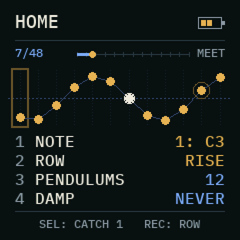</p>

The picture shows the row from above: each bob swings across its lane, the blue line is where it strikes, the thin
line through the bobs is the wave. A struck bob flashes; a caught one is an empty circle. The picked one is framed
(red while REC is on).

| Knob | | |
| --- | --- | --- |
| 1 | **NOTE** | The picked pendulum's note, a step of the scale |
| 2 | **ROW** | A shape for all twelve: RISE (low and slow on the left, high and fast on the right), FALL, ARCH, VALLEY, ZIGZAG, CHORD (stacked thirds), FIFTHS, SCATTER (new every turn) |
| 3 | **PENDULUMS** | How many swing, 1 to 12 |
| 4 | **DAMP** | NEVER, or how many cycles until they come to rest (1 to 32). The sound fades with the swing. PLAY again to release them |

## SEQ: the swing

<p align="center">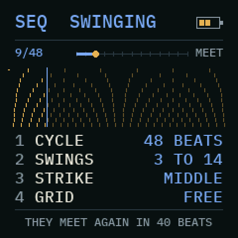</p>

The picture is the whole cycle at once: a lane for each pendulum, a mark for each strike, the blue line is now. Where
many marks line up in a column, the pendulums meet.

| Knob | | |
| --- | --- | --- |
| 1 | **CYCLE** | 4, 6, 8, 12, 16, 24, 32, 48, 64, 96 or 128 beats until they meet again |
| 2 | **SWINGS** | The slowest pendulum's swings in a cycle (1..24); the others make one more each ("3 TO 14") |
| 3 | **STRIKE** | Where a bob strikes. **MIDDLE**: passing the middle, both ways (twice a swing). **ONE WAY**: the middle, left to right only. **LEFT WALL**: at the left, once a swing; all twelve strike together on the downbeat. **BOTH WALLS**: at each side, twice a swing, panned to that side |
| 4 | **GRID** | **FREE**: the strikes fall where physics puts them. **1/32 .. 1/4**: each strike waits for the next grid line, and the pendulum wave turns into twelve interlocking Euclidean rhythms |

## ARP: the pendulums play your keys

<p align="center">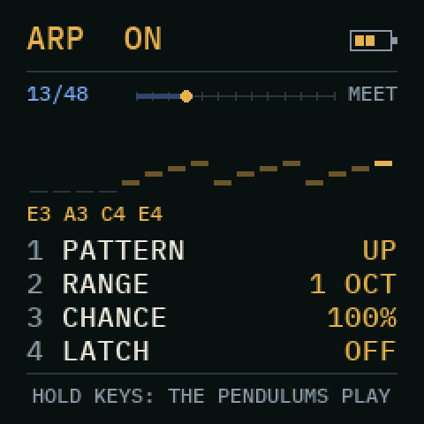</p>

With the ARP on, hold a chord: every strike takes its note from the keys you hold instead of the row. Let go and they
play the row again.

| Knob | | |
| --- | --- | --- |
| 1 | **PATTERN** | UP, DOWN, BOUNCE, RANDOM, or **SPREAD**: pendulum 1 plays your lowest note, pendulum 2 the next, ... |
| 2 | **RANGE** | 1 to 4 octaves |
| 3 | **CHANCE** | How often a strike plays (the others are silent) |
| 4 | **LATCH** | ON: the chord stays when you let go; the next chord replaces it |

## EDIT: the bobs

<p align="center">
  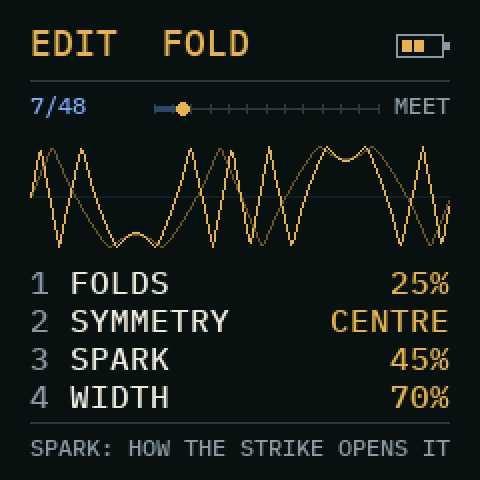
  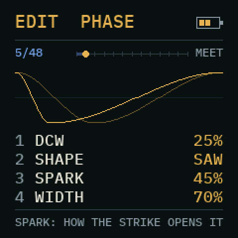
  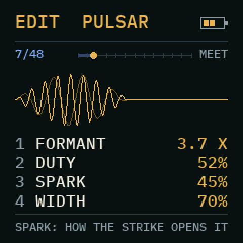
</p>
<p align="center"><sub>FOLD · PHASE · PULSAR</sub></p>

ALGORITHM chooses what a strike sounds like. The picture is one cycle of the wave: dim at rest, bright at the strike.

| Engine | KNOB 1 | KNOB 2 | Sound |
| --- | --- | --- | --- |
| **FOLD** | **FOLDS**: how hard the sine is folded | **SYMMETRY**: folds one side more (even harmonics) | West Coast: a wavefolder into a low-pass gate, the "bongo" ping of a vactrol |
| **PHASE** | **DCW**: how far the cosine's phase is bent | **SHAPE**: SAW, SQUARE, PULSE, DOUBLE | Casio CZ phase distortion: from a pure tone to a bright saw or pulse |
| **PULSAR** | **FORMANT**: the grain's pitch, 1x to 12x | **DUTY**: how much of each cycle the grain fills | Pulsar synthesis: a short grain of sine each cycle; vocal, glassy, buzzing |

| Knob | | |
| --- | --- | --- |
| 3 | **SPARK** | How much the strike opens the sound (the envelope adds to KNOB 1) |
| 4 | **WIDTH** | Stereo: the row spread from left (pendulum 1) to right (pendulum 12); BOTH WALLS: the wall it touched |

## ENV: every strike

<p align="center">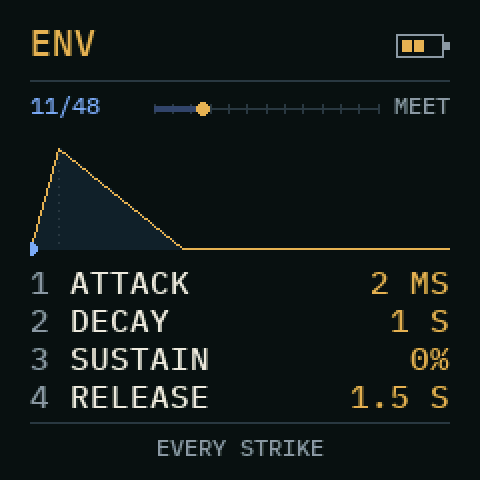</p>

ATTACK, DECAY, SUSTAIN, RELEASE. A strike holds for half the time to that bob's next strike, then RELEASE. A key you
play holds as long as you hold it.

## LFO

<p align="center">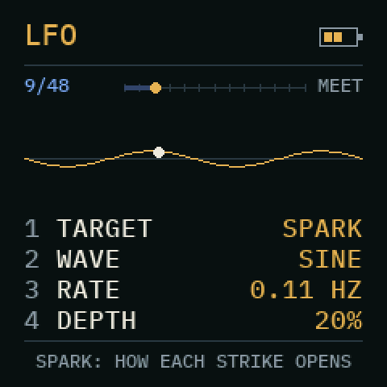</p>

| Knob | | |
| --- | --- | --- |
| 1 | **TARGET** | **PITCH** (±1 semitone); **FOLDS** (KNOB 1 of EDIT, ±50 %; with PHASE it reads **DCW**, with PULSAR **FORMANT**); **SPARK** (±100 %: how much each strike opens the sound); **LEVEL**; or **GRAVITY**: the pendulums' time is pulled ahead and held back. They still meet at the end of the cycle |
| 2 | **WAVE** | SINE, TRIANGLE, RANDOM, DRIFT |
| 3 | **RATE** | 0.01 to 20 Hz |
| 4 | **DEPTH** | 0 to 100 % |

## FX

<p align="center">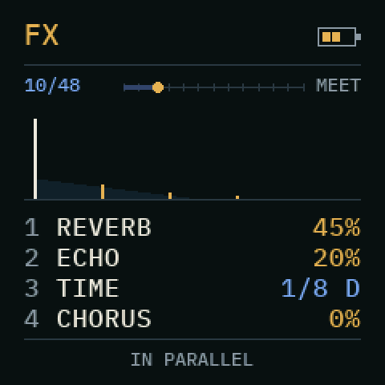</p>

REVERB, ECHO, TIME (the echo, 1/32 to a dotted 1/4, on the tempo) and CHORUS, in parallel.

## GLO

<p align="center">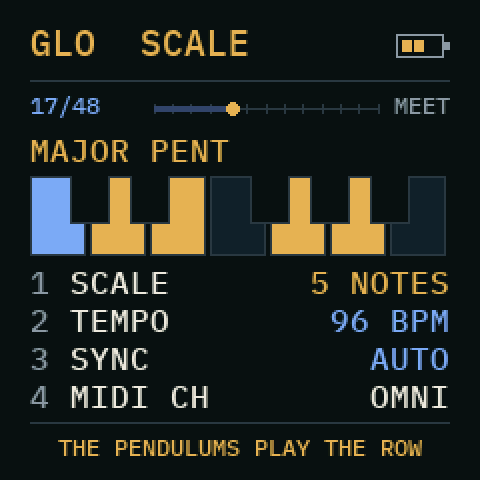</p>

| Knob | | |
| --- | --- | --- |
| 1 | **SCALE** | 48 scales (also SELECT). The piano shows it, the root in blue |
| 2 | **TEMPO** | 40 to 240 BPM; "MIDI" when a clock leads |
| 3 | **SYNC** | AUTO (a MIDI clock that comes in leads) or INTERNAL |
| 4 | **MIDI CH** | OMNI or 1..16, in and out |

The keys transpose everything (C4 = no transposition), OCT− / OCT+ by an octave.

## Presets

| | | |
| --- | --- | --- |
| 1 | PLUMB LINE | FOLD, a rising row, 48 beats, the middle |
| 2 | MUSIC BOX | PULSAR, an arch, both walls, on a 1/16 grid |
| 3 | FOUCAULT | PHASE saw, stacked thirds, the left wall, GRAVITY |
| 4 | TIDE CLOCK | FOLD, a valley in Hirajoshi, one way, 64 beats |
| 5 | LEAD LINE | PHASE pulse, a zigzag, fast, on 1/16 |
| 6 | SHIP'S BELL | PULSAR, fifths in slendro, eight pendulums that tire in 8 cycles |
| 7 | SLACK WATER | FOLD, pelog, slow pads, GRAVITY drifting |
| 8 | SEXTANT | PHASE square, a scattered row in double harmonic, both walls, on 1/8 |

USER 1..8 start as copies of these. SAVE keeps them; nothing else is kept (the octave, the tempo, SYNC and the MIDI
channel are saved with SAVE too). A MIDI program change chooses a preset.

## MIDI

- **In**: notes play like the keys (with the ARP on: the chord), the sustain pedal, CC 7 volume, all notes off,
  program change. Clock and START / STOP / CONTINUE: a master leads the tempo, and its START releases the pendulums.
- **Out**: every strike, as a note on the MIDI channel, and the keys you play.
- **USB audio**: the FM‑1 is a stereo audio input for your computer or phone.
- **FM‑1 Mirror** and the **backup page** work as in every Dinghy firmware.

## If something goes wrong

Hold **OCT−** while switching on: the FM‑1 starts in the USB rescue mode, where any firmware can be installed again.
The [Firmware Hub](https://thefirmwarehub.com/tools/rescue/) explains the way back to the official firmware.
